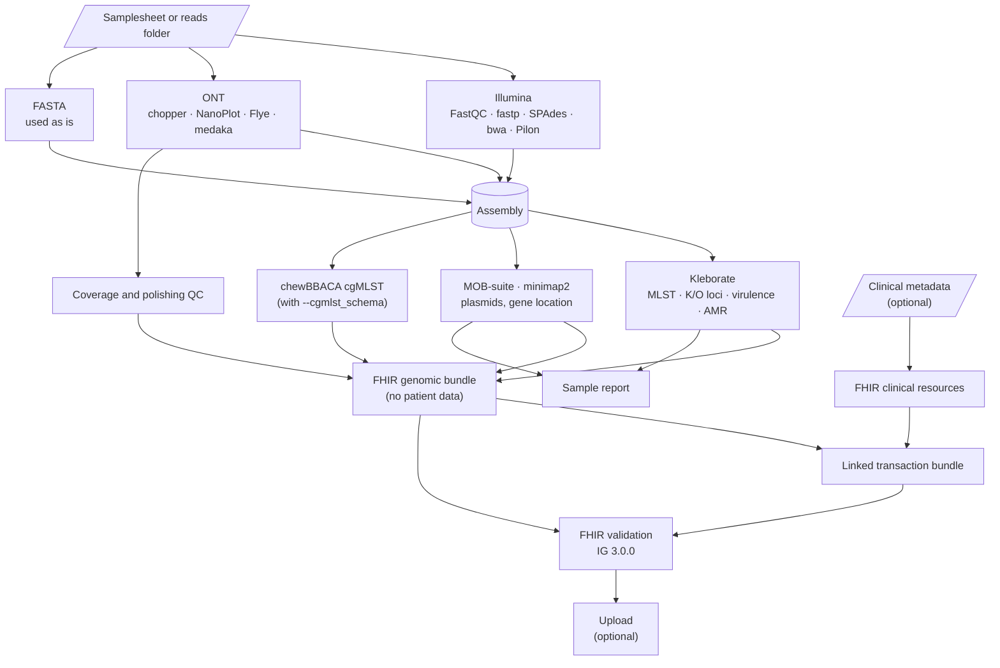

# Pipeline architecture

Every sample follows the branch for its platform to an assembly, then joins the shared steps. The
plasmid, cgMLST, clinical, link and upload steps run only when their parameters are given (the
plasmid step runs by default).

